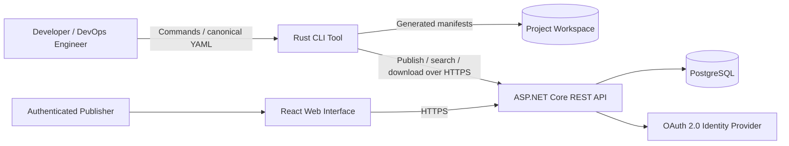
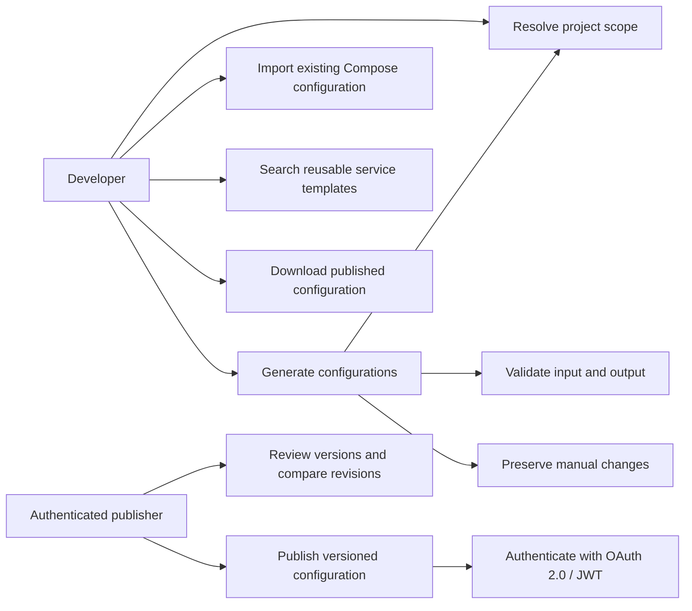
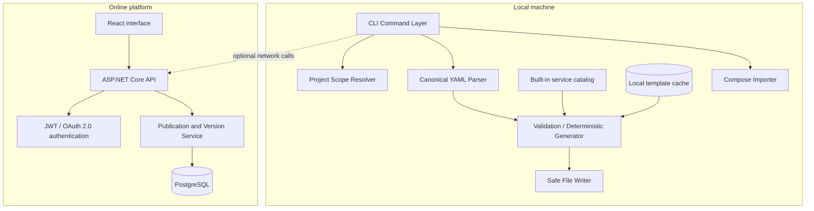

# 7. Architecture and Diagrams

Document purpose. This section describes the proposed architecture and intended user interactions of the infrastructure configuration tool. It distinguishes the target design from functionality verified in the public repository. It complements the Project Proposal and Requirements Specification.

## 7.1 Evidence and status

The public GitHub repository (https://github.com/GorkiyChocolate/Diploma-Project) currently exposes the top-level directories backend/, cli/, and frontend/ and a minimal README. These facts establish the repository layout but do not independently establish which user-facing commands, API endpoints or interface screens are operational. The development team reports that CLI and backend components are in development with some running parts; the React user interface remains a planned/in-progress area. All diagrams below therefore describe the target design, not a completed deployment.

## 7.2 Architectural drivers

| Driver | Proposed architectural response |
| --- | --- |
| Offline-first core workflows | Parsing, local catalog lookup, scope resolution, generation and validation execute in Rust without a mandatory network connection. |
| One declarative description | A canonical YAML input model is transformed by separate output-format generators. |
| Safe updates | Validate paths and generated content; avoid silently replacing user-authored files; support explicit confirmation or force semantics if implemented. |
| Reusable services | Ship an initial curated catalog of about ten popular services across three recent versions each, subject to catalog verification; cache downloaded additional recipes locally. |
| Optional distribution | Provide an ASP.NET Core API, PostgreSQL metadata and a React interface for publication, discovery and version retrieval. |
| Traceability | Use deterministic outputs, version identifiers, change history and acceptance tests; no deployment execution required for core MVP. |

## 7.3 System context diagram

**Editable source:** [`../diagrams/sources/system_context.mmd`](../diagrams/sources/system_context.mmd).

*Figure 7.1 — Proposed system context (logical boundaries).*

The developer operates primarily through the local CLI. Files are generated into a resolved project workspace; publication and discovery are online operations. The remote platform handles accounts, catalog metadata, recipe versions and distribution. Third-party identity providers are involved only when OAuth-based sign-in is enabled.

## 7.4 Use case diagram

**Editable source:** [`../diagrams/sources/use_case.mmd`](../diagrams/sources/use_case.mmd).

*Figure 7.2 — Intended primary user interactions (not an implementation status report).*

Project scope discovery is a prerequisite of generation, not a separate mandatory user workflow. An authenticated publisher is a specialization of a user when server-side publication or account-managed versions are involved. Importing an existing Compose file and generating from canonical YAML are distinct actions in the same local tool.

## 7.5 Component diagram

**Editable source:** [`../diagrams/sources/component_diagram.mmd`](../diagrams/sources/component_diagram.mmd).

*Figure 7.3 — Proposed client/server component decomposition.*

The CLI command layer coordinates local modules. The scope resolver searches for a .git boundary and otherwise uses the invocation directory as the working scope; exact traversal and stop conditions must be verified during implementation. A parser converts input into a validated in-memory representation, and output adapters produce Docker Compose, Kubernetes Deployment and CI/CD definitions. A safe writer prevents accidental loss of edits. The API and web application supply optional remotely hosted capabilities.

## 7.6 Data and responsibility boundaries

| Component | Responsibilities | Boundaries / notes |
| --- | --- | --- |
| Rust CLI | Parse commands; resolve workspace; import/generate/validate; manage local recipes | No mandatory server dependency for local generation. |
| Bundled catalog / cache | Resolve approved service templates and downloaded recipe versions | Service version availability and provenance must be checked before release. |
| Output generators | Build format-specific YAML files from the canonical model | Generate files only; does not claim cluster or container deployment. |
| ASP.NET Core API | Manage identities, publishing, search and metadata access | JWT and third-party OAuth 2.0 sign-in are target capabilities. |
| PostgreSQL | Store structured records for users, configuration metadata and versions | Blob/object storage design for full recipe payloads is not yet confirmed. |
| React web application | Support discovery, version browsing and account operations | Actual screen inventory requires frontend validation. |

## 7.7 Critical execution paths

### Local generation

1. Read command and working directory. 2. Resolve Git-root scope or invocation-directory fallback. 3. Locate and parse canonical YAML or initiate the documented import flow. 4. Resolve templates from bundled library and local cache. 5. Validate mandatory fields, references, dependencies and output constraints. 6. Generate target-format files deterministically. 7. Check output conflicts and either preserve existing files or require an explicit update policy. 8. Report generated paths, warnings and actionable errors.

### Online publication and retrieval

1. Authenticate through the platform. 2. Validate the recipe and identify semantic version. 3. Submit recipe metadata and content to the API. 4. Store version and provenance records. 5. Permit authorized users to search and retrieve a selected version. 6. Cache retrieved materials locally for future offline generation where permitted. Conflict policy, authorization roles and API contracts remain design decisions rather than validated behavior.

## 7.8 Cross-cutting architectural constraints

Security: avoid secrets in generated examples; validate externally obtained recipes; treat downloaded templates as untrusted input until checked. Reliability: use atomic or rollback-safe writes where practical and preserve user changes. Compatibility: define supported format versions and test each generator against canonical validators. Extensibility: keep output adapters independent of the command parser and catalog storage. Observability: provide intelligible CLI diagnostics and audit-relevant server events without exposing secrets.

